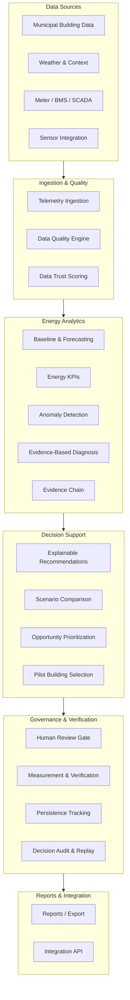

<p align="center">
  
</p>

# Smart Building Energy

**AI-Powered Building Energy Decision Support**

[](https://smart-building-energy-demo.netlify.app)
[](https://smart-building-energy-demo.netlify.app)
[](#decision-governance)
[](#measurement--verification)
[](#technology)

---

> **Smart Building Energy** transforms building and city data into explainable, traceable and human-reviewed engineering decisions.

---

## Live Demo

**[https://smart-building-energy-demo.netlify.app](https://smart-building-energy-demo.netlify.app)**

| Field | Value |
|---|---|
| Username | `demo` |
| Password | `A1234` |

> ⚠️ **DEMO ENVIRONMENT — no production control. All operational energy values are synthetic demo data only.**

---

## Table of Contents

- [What It Does](#what-it-does)
- [Core Workflow](#core-workflow)
- [Key Capabilities](#key-capabilities)
- [Why It Is Different](#why-it-is-different)
- [Rostock Reference Case](#rostock-reference-case)
- [Product Architecture](#product-architecture)
- [Decision Governance](#decision-governance)
- [Data Trust](#data-trust)
- [Measurement & Verification](#measurement--verification)
- [Current Maturity](#current-maturity)
- [Pilot Roadmap](#pilot-roadmap)
- [Technology](#technology)
- [Screenshots](#screenshots)
- [Documentation](#documentation)
- [Contact](#contact)

---

## What It Does

Smart Building Energy is a **decision support platform** for municipalities, energy managers and smart-city programs. It ingests building and energy data, runs deterministic engineering workflows, and produces explainable, auditable recommendations — always subject to human review before any action.

It is **not** an autonomous control system. Every recommendation is a suggestion, not a command.

---

## Core Workflow

```
Energy Data
  → Detect (anomaly detection)
  → Diagnose (evidence-based root cause analysis)
  → Evidence (traceability chain)
  → Recommend (explainable engineering suggestion)
  → Compare (scenario comparison)
  → Prioritize (opportunity scoring)
  → Human Review (mandatory gate)
  → Verify (measurement & verification)
  → Persist (savings persistence tracking)
  → Audit (decision audit log)
  → Replay (audit replay workflow)
  → Trust (data trust scoring)
```

---

## Key Capabilities

| Capability | Description |
|---|---|
| **Energy Monitoring** | Portfolio-level and building-level energy KPIs |
| **Anomaly Detection** | Deterministic rule-based anomaly flagging |
| **Evidence-Based Diagnosis** | Root cause chains with evidence citations |
| **Decision Trace** | Full step-by-step decision traceability |
| **Decision Audit & Replay** | Immutable audit log, snapshot-based replay |
| **Data Trust & Uncertainty** | 6-dimension data quality scoring |
| **Scenario Comparison** | Side-by-side intervention scenario analysis |
| **Opportunity Prioritization** | Deterministic priority scoring across portfolio |
| **Measurement & Verification** | Baseline, savings calculation, M&V workflow |
| **Persistence Tracking** | Tracks whether energy savings persist over time |
| **Pilot Building Selection** | Screening and shortlist for pilot candidates |
| **City Inventory Integration** | Real public building inventory integration |
| **Human-in-the-Loop Governance** | Every recommendation requires human approval |
| **Multilingual Interface** | Full DE / EN / TR interface |

---

## Why It Is Different

| Principle | What It Means in Practice |
|---|---|
| **Evidence Traceability** | Every diagnosis links to the data that supports it |
| **Estimated ≠ Verified** | The platform distinguishes baseline estimates from meter-verified results |
| **Recommendation ≠ Command** | No action is taken without explicit human approval |
| **Diagnosis ≠ Causality** | Anomalies are flagged; causality is not automatically claimed |
| **Human Review Required** | A mandatory human-in-the-loop gate exists before every intervention |
| **M&V + Persistence** | Savings are tracked after intervention, not just projected before |
| **Decision Audit & Replay** | Every decision can be replayed from its original snapshot |
| **Real Data ≠ Demo Data** | Public inventory data is explicitly separated from synthetic demo data |
| **Data Trust Instead of AI Confidence** | Uncertainty is communicated as data quality, not model confidence |

---

## Rostock Reference Case

The platform uses the **City of Rostock, Germany** as its reference implementation because:

- Rostock has a **publicly available CC0-licensed building and city inventory** that enables honest integration testing
- The integration demonstrates the full pipeline from real city inventory to pilot candidate selection
- It provides a realistic starting point for a municipal pilot engagement

**What is real in the Rostock integration:**

- Building inventory (addresses, use types, year of construction, floor areas) sourced from public CC0 city data
- Geographic data
- Pilot building screening and shortlist (derived from public inventory)

**What is NOT real in the demo:**

- Operational energy meter readings — all synthetic demo data
- BMS/SCADA data — not available; not claimed
- Actual anomaly events — simulated for demonstration purposes
- Energy savings results — estimated/projected; no real M&V baseline exists yet

> Real meter and BMS data onboarding is a prerequisite for a live municipal pilot. See [ROSTOCK_REFERENCE_CASE.md](docs/ROSTOCK_REFERENCE_CASE.md).

---

## Product Architecture



---

## Decision Governance

The platform enforces an explicit governance chain:

| Step | Description |
|---|---|
| **Detect** | Anomaly flagging — does not imply cause |
| **Diagnose** | Evidence-based root cause hypothesis |
| **Evidence** | Data citations supporting the diagnosis |
| **Recommend** | Engineering suggestion with explicit assumptions |
| **Human Review** | Mandatory human approval gate |
| **Verify** | Post-intervention measurement |
| **Persist** | Long-term savings persistence tracking |
| **Audit** | Immutable decision log |
| **Replay** | Snapshot-based decision replay |

**Core distinctions enforced:**

```
Anomaly ≠ Diagnosis
Diagnosis ≠ Causality
Recommendation ≠ Command
Estimated ≠ Verified
No Autonomous Control
Human Review Required
```

See [DECISION_GOVERNANCE.md](docs/DECISION_GOVERNANCE.md) for the full specification.

---

## Data Trust

Every data item carries a **Data Trust score** across 6 dimensions:

| Dimension | Description |
|---|---|
| `DATA_COMPLETENESS` | How complete is the available data |
| `SOURCE_TRACEABILITY` | Can the data source be traced and verified |
| `EVIDENCE_SUPPORT` | How much evidence supports the conclusion |
| `MEASUREMENT_STATUS` | Measured / Derived / Estimated / Verified / Not Available |
| `MODEL_DEPENDENCY` | How dependent is the result on model assumptions |
| `MISSING_CRITICAL_DATA` | Is critical data absent |

**Trust categories:** `HIGH` · `MODERATE` · `LIMITED` · `INSUFFICIENT`

> Data Trust describes **data and evidence quality**. It does not prove causality.

See [DATA_TRUST.md](docs/DATA_TRUST.md) for the full specification.

---

## Measurement & Verification

The platform implements a full **M&V workflow**:

- Baseline period definition
- Adjustment for weather, occupancy and operating conditions
- Post-intervention measurement
- Savings calculation (adjusted baseline minus measured)
- Persistence tracking over time
- Explicit separation of **estimated** vs **verified** savings

No energy savings are claimed without a verified M&V baseline. See [MV_AND_PERSISTENCE.md](docs/MV_AND_PERSISTENCE.md).

---

## Current Maturity

| Aspect | Status |
|---|---|
| **Stage** | Functional prototype / live demo |
| **City inventory integration** | Real public CC0 inventory (Rostock) |
| **Engineering workflows** | Deterministic, rule-based, fully explainable |
| **Frontend** | Complete, deployed, multilingual (DE/EN/TR) |
| **Decision governance** | Fully implemented |
| **M&V workflow** | Implemented; real baseline pending live pilot |
| **Real operational meter data** | Pending live pilot onboarding |
| **TRL** | Prototype — not TRL 9 |

> Real operational meter and BMS integration is the next critical step toward a production-grade deployment.

---

## Pilot Roadmap

| Phase | Focus |
|---|---|
| **Phase 1** | Data & Building Selection — inventory integration, pilot candidate screening |
| **Phase 2** | Baseline / Meter / BMS Integration — real meter onboarding, baseline establishment |
| **Phase 3** | Anomaly / Diagnosis / Recommendation — live anomaly workflow with real data |
| **Phase 4** | Human Review / Intervention — first approved interventions |
| **Phase 5** | M&V / Persistence — savings measurement and tracking |
| **Phase 6** | Portfolio Scaling — expansion to full building portfolio |

See [ROADMAP.md](docs/ROADMAP.md) for the detailed roadmap.

---

## Technology

The platform is built entirely with:

| Component | Technology |
|---|---|
| **Frontend** | Vanilla HTML5 / CSS3 / JavaScript (ES6+) |
| **Charts** | Chart.js 4.4.4 |
| **Backend** | Python 3.12 |
| **Data models** | Pydantic 2.x |
| **Database ORM** | SQLAlchemy 2.x |
| **Data processing** | pandas 2.2, pyarrow 17 |
| **Storage** | SQLite (persistent) |
| **Deployment** | Static frontend (Netlify) |
| **Interface languages** | German (DE) · English (EN) · Turkish (TR) |
| **Code quality** | Ruff, Pyright / mypy, pytest |

No proprietary AI model dependencies. No third-party AI API calls in the core decision engine. All engineering workflows are deterministic and fully explainable.

---

## Screenshots

> Screenshots to be added — live demo available at [https://smart-building-energy-demo.netlify.app](https://smart-building-energy-demo.netlify.app)

| Screen | Description |
|---|---|
| Portfolio Overview | Building portfolio energy KPI dashboard |
| Energy Monitoring | Per-building energy time series and KPIs |
| Anomaly Detection | Flagged anomalies with rule citations |
| Evidence Chain | Root cause evidence traceability |
| Building Health | Health score and risk indicators |
| Recommendations | Prioritized engineering recommendations |
| Decision Trace | Full step-by-step decision workflow |
| Data Trust | 6-dimension data quality scoring |
| Scenario Comparison | Side-by-side scenario analysis |
| Pilot Building Selection | Pilot candidate screening and shortlist |
| M&V | Measurement & Verification workflow |
| Persistence | Savings persistence tracking |

---

## Documentation

| Document | Description |
|---|---|
| [PRODUCT_OVERVIEW.md](docs/PRODUCT_OVERVIEW.md) | Full product description and positioning |
| [ARCHITECTURE.md](docs/ARCHITECTURE.md) | System architecture and component design |
| [DECISION_GOVERNANCE.md](docs/DECISION_GOVERNANCE.md) | Decision governance chain specification |
| [ROSTOCK_REFERENCE_CASE.md](docs/ROSTOCK_REFERENCE_CASE.md) | Rostock reference case and data separation |
| [DATA_TRUST.md](docs/DATA_TRUST.md) | Data trust model and uncertainty handling |
| [MV_AND_PERSISTENCE.md](docs/MV_AND_PERSISTENCE.md) | Measurement & Verification workflow |
| [PILOT_BUILDING_SELECTION.md](docs/PILOT_BUILDING_SELECTION.md) | Pilot building selection methodology |
| [ROADMAP.md](docs/ROADMAP.md) | Product roadmap and development phases |
| [SECURITY_AND_PRIVACY.md](docs/SECURITY_AND_PRIVACY.md) | Security and data privacy principles |

---

## Who Is This For

| Audience | Relevance |
|---|---|
| **Municipalities** | Portfolio-level building energy governance with full audit trail |
| **Smart-City Programs** | Scalable, data-agnostic decision support infrastructure |
| **Accelerators / Investors** | Early-stage platform with real city integration and rigorous governance |
| **Energy Managers** | Evidence-based diagnosis and M&V workflow |
| **Engineering Partners** | Well-defined integration contracts for BMS/meter/sensor data |
| **BMS / Meter / Sensor Vendors** | Open integration architecture with explicit data quality handling |

---

## Contact

**ILHAN CEKIC, PhD**

[LinkedIn — Ilhan Cekic](https://www.linkedin.com/in/ilhan-cekic-212b4a4a/)

---

## License

This repository contains **public showcase documentation only**. No proprietary source code, algorithms, datasets or credentials are included.

See [LICENSE-NOTICE.md](LICENSE-NOTICE.md) for details.

---

*Smart Building Energy — AI-Powered Building Energy Decision Support*
